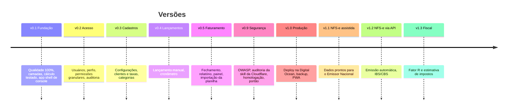

# Roadmap

Atualizado em 2026-10-29.

A segurança acompanha todas as versões ([seguranca/](seguranca/README.md)) e tem uma etapa própria, a **v0.9**, que funciona como portão: nada vai para a web sem passar por ela.

O objetivo da **v1.0** é substituir a planilha por completo: lançar horas pelo celular ou pelo computador, fechar o mês de cada cliente, gerar o relatório que acompanha a nota e controlar quem acessa o quê. A emissão da NFS-e vem depois, em etapas.

## Versões

### v0.1 — Fundação · ✅ Concluída

Base técnica e visual sobre a qual todo o resto é construído.

- [x] Pasta `docs/` com roadmap, regras, funcionalidades, telas e linguagem visual
- [x] Ambiente de desenvolvimento com Sail e MySQL ([ADR-0012](arquitetura/adr/0012-mysql-e-sail.md))
- [x] Repositório no GitHub com Conventional Commits ([contribuindo.md](contribuindo.md))
- [x] CI: Pint, PHPStan nível máximo, testes com cobertura mínima de 100% ([ADR-0009](arquitetura/adr/0009-qualidade-e-fluxo-de-trabalho.md))
- [x] Testes de arquitetura entre camadas ([ADR-0002](arquitetura/adr/0002-arquitetura-em-camadas.md))
- [x] Value Objects `Money`, `Minutes`, `Points` ([ADR-0004](arquitetura/adr/0004-dinheiro-e-tempo-em-inteiros.md))
- [x] `BillingCalculator` e políticas de arredondamento, com testes das regras RN-01, RN-05, RN-06 e RN-07
- [x] CI de segurança: `composer audit`, `npm audit` e gitleaks bloqueando o merge (SEC-14)
- [x] Testes de arquitetura contra `DB::raw`, `{!! !!}` e `unserialize` (SEC-23, SEC-24, SEC-39)
- [x] Skill `security-audit` da Cloudflare instalada ([ADR-0011](arquitetura/adr/0011-auditoria-de-seguranca.md))
- [x] Locale `pt_BR`, fuso de exibição `America/Sao_Paulo` (banco em UTC) e traduções da interface
- [x] Tokens visuais e app shell no estilo console (referência: telas do GCP) ([linguagem-visual.md](design/linguagem-visual.md))
- [x] Login traduzido e sem cadastro público ([F-01](funcionalidades/F-01-acesso-e-seguranca.md))

### v0.2 — Acesso · ✅ Concluída

- [x] [F-17 Usuários e permissões](funcionalidades/F-17-usuarios-e-permissoes.md): catálogo, perfis, exceções, auditoria
- [x] [F-01 Acesso e segurança](funcionalidades/F-01-acesso-e-seguranca.md): convite por e-mail, desativação
- [x] Componente `ui.guarded-content` (os demais elementos usam `@can`)
- [x] Navegação sem recarregar a página: barra e menu persistem entre telas, sem baixar o CSS de novo
- [x] Auditoria `quick` do diff da v0.1 + v0.2 (run-2: A-08 a A-10 corrigidos)

### v0.3 — Cadastros · 🚧 Em andamento

- [x] [F-02 Configurações do prestador](funcionalidades/F-02-configuracoes-do-prestador.md)
- [x] [F-03 Clientes e taxas](funcionalidades/F-03-clientes-e-taxas.md)
- [ ] [F-04 Categorias](funcionalidades/F-04-categorias.md)

### v0.4 — Lançamentos · 📋 Planejado

- [ ] [F-05 Lançamentos de horas](funcionalidades/F-05-lancamentos-de-horas.md)
- [ ] [F-06 Cronômetro](funcionalidades/F-06-cronometro.md)

### v0.5 — Faturamento · 📋 Planejado

- [ ] [F-08 Períodos de faturamento](funcionalidades/F-08-periodos-de-faturamento.md)
- [ ] [F-09 Relatório do período](funcionalidades/F-09-relatorio-do-periodo.md)
- [ ] [F-10 Painel](funcionalidades/F-10-painel.md)
- [ ] [F-07 Importação da planilha](funcionalidades/F-07-importacao-da-planilha.md) (agosto a outubro de 2026)

### v0.9 — Segurança (OWASP) · 📋 Planejado

Portão de segurança antes da web. Detalhes em [seguranca/README.md](seguranca/README.md); decisões em [ADR-0010](arquitetura/adr/0010-cloudflare-na-borda.md) e [ADR-0011](arquitetura/adr/0011-auditoria-de-seguranca.md).

**Preparação**

- [ ] Ambiente de homologação na Digital Ocean, atrás da Cloudflare (Tunnel + Access), com dados fictícios
- [ ] Controles `SEC-xx` previstos para v0.9 implementados: cabeçalhos e CSP, cookies, `APP_DEBUG` desligado, Turnstile, 2FA obrigatório para administradores, alertas de segurança, rotação da `APP_KEY`
- [ ] Configuração da Cloudflare conforme o checklist de [operacao/deploy.md](operacao/deploy.md)

**Descoberta de falhas**

- [ ] Auditoria completa com a skill `security-audit`, perfil `deep`
- [ ] Checklist OWASP ASVS 5.0 nível 2 revisado item a item
- [ ] OWASP ZAP: varredura completa autenticada (administrador e usuário comum) na homologação
- [ ] SSL Labs, Mozilla Observatory e varredura externa de portas
- [ ] Testes de abuso das permissões: cada perfil tentando ações fora do seu catálogo por requisição direta

**Correção e verificação**

- [ ] Todo achado registrado em [seguranca/achados.md](seguranca/achados.md), com teste de regressão na correção
- [ ] Nova execução da skill (perfil `quick` sobre as correções) e do ZAP
- [ ] Plano de resposta a incidentes e restauração de backup testados

**Critério de saída:** nenhum achado `confirmed` crítico ou alto aberto, todos os `needs_validation` decididos por escrito, notas A+ no SSL Labs e no Observatory.

### v1.0 — Produção · 📋 Planejado

Marco: a planilha deixa de ser usada.

- [ ] Infraestrutura na Digital Ocean ([operacao/deploy.md](operacao/deploy.md))
- [ ] MySQL gerenciado da DO com backups e teste de restauração documentado ([ADR-0012](arquitetura/adr/0012-mysql-e-sail.md))
- [ ] [F-11 PWA e experiência mobile](funcionalidades/F-11-pwa-e-experiencia-mobile.md)
- [ ] Publicação somente após o critério de saída da v0.9
- [ ] OWASP ZAP baseline semanal agendado contra produção

### v1.1 — NFS-e assistida · 📋 Planejado

- [ ] [F-12 Emissão de NFS-e](funcionalidades/F-12-emissao-de-nfse.md) — etapa A: o sistema prepara os dados, a emissão é feita no Emissor Nacional e o XML/PDF é anexado

### v1.2 — NFS-e via API · 📋 Planejado

**Prazo externo:** campos de IBS/CBS passam a valer para o Simples Nacional em **2027-01-01** ([fiscal/nfse.md](fiscal/nfse.md)).

- [ ] [F-12 Emissão de NFS-e](funcionalidades/F-12-emissao-de-nfse.md) — etapa B: emissão pela API do Emissor Nacional, homologação antes de produção
- [ ] Cancelamento e consulta de status
- [ ] Auditoria `deep` da skill `security-audit` focada em certificado, XML e emissão antes de emitir em produção

### v1.3 — Fiscal · 📋 Planejado

- [ ] [F-14 Fator R e estimativa de impostos](funcionalidades/F-14-fator-r-e-impostos.md)
- [ ] Meta mensal e previsão de fechamento no painel ([F-10](funcionalidades/F-10-painel.md))

## Backlog (sem versão)

| ID | Ideia |
|---|---|
| [F-13](funcionalidades/F-13-link-publico-do-relatorio.md) | Link público do relatório para o cliente aprovar antes da nota |
| [F-15](funcionalidades/F-15-lembretes.md) | Lembretes: dia sem lançamento, fechamento do mês, nota não paga |
| [F-16](funcionalidades/F-16-integracao-linear.md) | Integração com o Linear para puxar o título das tarefas |
| — | Projetos dentro de um cliente |
| — | Despesas reembolsáveis no período |
| — | Login por passkey |
| — | Permissão por registro (ex.: usuário só vê o cliente X) |
| [F-17](funcionalidades/F-17-usuarios-e-permissoes.md) | "Ver como": pré-visualização somente leitura da navegação com as permissões de outro usuário (hoje a aba Permissões mostra o estado efetivo e a origem de cada item) |
| — | Mutation testing (Infection) |

## Fora do escopo

- Multiempresa: o sistema atende uma única empresa prestadora, com vários usuários.
- Emissão de NF-e de produto.
