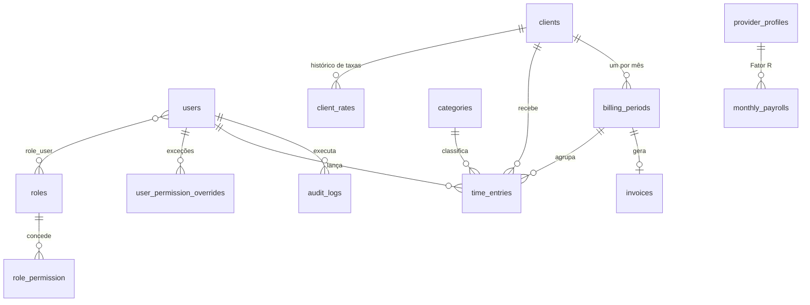

# Modelo de dados

Banco MySQL 8.4 ([ADR-0012](adr/0012-mysql-e-sail.md)). Valores monetários em centavos (`*_cents`), tempo em minutos (`*_minutes`), datas em UTC no banco e exibidas em `America/Sao_Paulo`.

## Tabelas

### users — [F-01](../funcionalidades/F-01-acesso-e-seguranca.md), [F-17](../funcionalidades/F-17-usuarios-e-permissoes.md)

Tabela do starter kit, com colunas adicionais:

| Coluna | Tipo | Observação |
|---|---|---|
| is_admin | bool | RN-17 |
| active | bool | RN-19 |
| invited_at, last_login_at | datetime, nulo | |

### roles, role_permission, role_user — RN-15, RN-16

| Tabela | Colunas |
|---|---|
| roles | id, name (único), description |
| role_permission | role_id, permission_key (string, chave do catálogo) |
| role_user | role_id, user_id |

### user_permission_overrides — RN-16

| Coluna | Tipo | Observação |
|---|---|---|
| user_id | fk | |
| permission_key | string | Único por usuário |
| effect | enum | `allow` · `deny` |

### audit_logs — RN-20

| Coluna | Tipo | Observação |
|---|---|---|
| actor_id | fk users | Quem fez |
| subject_type, subject_id | string, int | Recurso afetado |
| event | string | Ex.: `role.permissions_changed`, `period.closed` |
| before, after | json, nulo | |
| created_at | datetime | Sem `updated_at`: registro imutável |

### provider_profiles — [F-02](../funcionalidades/F-02-configuracoes-do-prestador.md)

| Coluna | Tipo | Observação |
|---|---|---|
| id | int | |
| legal_name, trade_name | string | Razão social e nome fantasia |
| cnpj | char(14), nulo | Sem pontuação, letras maiúsculas (CNPJ alfanumérico) |
| municipal_registration | string(30) | Inscrição municipal (Canoas) |
| tax_regime | enum | `simples_me_epp` |
| default_rate_cents | int | Taxa padrão por hora, até 10.000.000 (R$ 100.000,00) |
| default_rounding_policy | enum | `per_period` · `per_entry` · `exact` |
| service_code_national, nbs_code, cnae | string | Códigos da NFS-e ([fiscal/nfse.md](../fiscal/nfse.md)) |
| service_description_template | text | Texto base da descrição da nota |
| address_street, address_number, address_complement, address_district, address_city | string | Endereço do prestador |
| address_state, address_zip_code | char(2), char(8) | UF e CEP só com dígitos |

### clients — [F-03](../funcionalidades/F-03-clientes-e-taxas.md)

| Coluna | Tipo | Observação |
|---|---|---|
| id | int | |
| name | string(60), único | Nome curto exibido nas telas |
| color | string | Uma das 8 cores de `ClientColor` |
| rounding_policy | string, nulo | Nulo = usa o padrão do prestador (RN-06) |
| legal_name | string, vazio | Razão social ou nome completo (tomador da nota) |
| document | string(14), nulo | CPF (11) ou CNPJ (14, pode ter letras), sem pontuação |
| email | string, vazio | Guardado em minúsculas |
| withholds_iss | bool | Cliente retém ISS |
| address_street, address_number, address_complement, address_district, address_city, address_state, address_zip_code | string, vazio | Mesmo formato de `provider_profiles`; completos (menos o complemento) para emitir nota |
| active | bool | RN-13 |

### client_rates — RN-04

| Coluna | Tipo | Observação |
|---|---|---|
| client_id | fk | Apagada junto com o cliente |
| rate_cents | int | Até `HourlyRate::MAX_CENTS` |
| valid_from | date | Único por cliente (índice `client_id` + `valid_from`) |

### categories — [F-04](../funcionalidades/F-04-categorias.md)

| Coluna | Tipo | Observação |
|---|---|---|
| name | string(40), único | |
| color | string | Uma das 8 cores de `Color` |
| billable | bool | RN-12 |
| active | bool | RN-13 |
| sort_order | int | Ordem nas listas; renumerada 1, 2, 3… ao reordenar |

### time_entries — [F-05](../funcionalidades/F-05-lancamentos-de-horas.md), [F-06](../funcionalidades/F-06-cronometro.md)

| Coluna | Tipo | Observação |
|---|---|---|
| user_id | fk | Quem trabalhou (RN-03, RN-14) |
| client_id, category_id | fk | |
| billing_period_id | fk | Preenchido ao salvar (RN-08) |
| description | string | |
| reference | string, nulo | Ex.: `MRP-62` |
| started_at | datetime | |
| ended_at | datetime, nulo | Nulo = cronômetro rodando (RN-14) |
| duration_minutes | int, nulo | Calculado ao salvar (RN-02) |
| rate_cents | int | Taxa vigente no início (RN-04) |
| source | enum | `manual` · `timer` · `import` |

| running_user_id | int, nulo, gerada | `user_id` enquanto `ended_at` é nulo; índice único garante um cronômetro por usuário (o MySQL não tem índice parcial) |

Índices: `(user_id, started_at)`, `(client_id, started_at)`, `running_user_id` único. Chaves estrangeiras com `restrictOnDelete`: cliente, categoria e usuário com lançamentos não são apagados.

### billing_periods — [F-08](../funcionalidades/F-08-periodos-de-faturamento.md)

| Coluna | Tipo | Observação |
|---|---|---|
| client_id | fk | |
| month | date | Primeiro dia do mês; único por cliente |
| status | enum | `open` · `closed` · `invoiced` · `paid` (RN-09) |

Na v0.4 a tabela tem só as colunas acima; as do snapshot abaixo chegam com o F-08.

| Coluna | Tipo | Observação |
|---|---|---|
| billable_minutes | int, nulo | Snapshot (RN-11) |
| rounding_minutes | int, nulo | Minutos adicionados pelo arredondamento |
| points | int, nulo | |
| rounding_policy | enum, nulo | |
| amount_cents | int, nulo | |
| closed_at | datetime, nulo | |
| paid_at | date, nulo | |
| paid_amount_cents | int, nulo | |

### invoices — [F-12](../funcionalidades/F-12-emissao-de-nfse.md)

| Coluna | Tipo | Observação |
|---|---|---|
| billing_period_id | fk | |
| issuer | string | `assisted_manual` · `nfse_nacional_api` |
| environment | enum | `homologation` · `production` |
| number | string, nulo | Número da NFS-e |
| access_key | string, nulo | Chave de acesso nacional |
| status | enum | `pending` · `authorized` · `rejected` · `cancelled` |
| amount_cents | int | |
| issued_at | datetime, nulo | |
| xml_path, pdf_path | string, nulo | Arquivos em disco privado |
| request_payload, response_payload | json, nulo | Para auditoria |
| error_message | text, nulo | |

### monthly_payrolls — [F-14](../funcionalidades/F-14-fator-r-e-impostos.md)

| Coluna | Tipo | Observação |
|---|---|---|
| month | date | Único |
| pro_labore_cents | int | |
| payroll_cents | int | Folha de empregados, se houver |
| other_revenue_cents | int | Receita fora do sistema, para o RBT12 |
