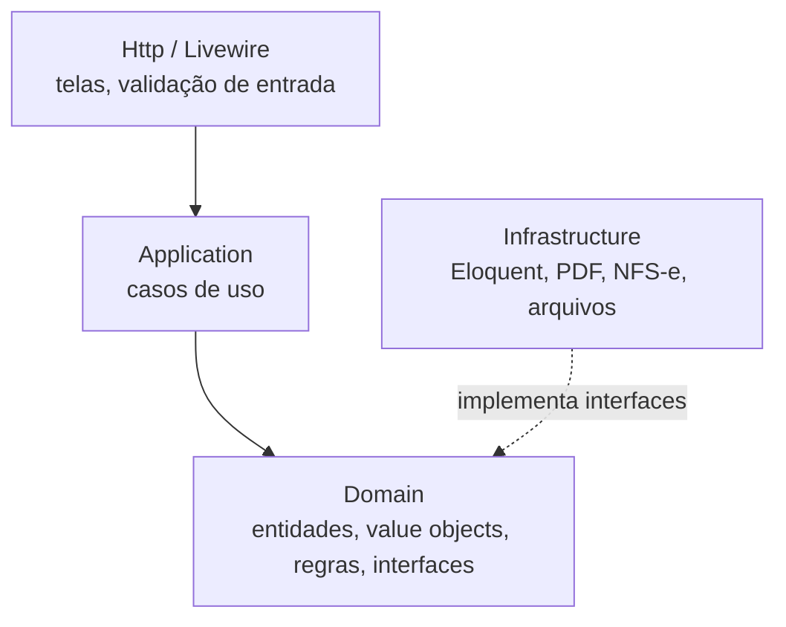
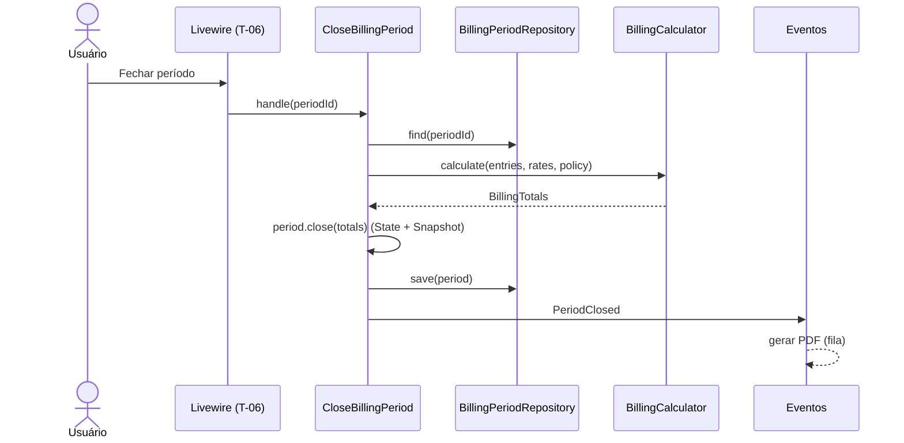

# Arquitetura — visão geral

Uma aplicação Laravel (monólito) organizada em camadas, com o domínio isolado do framework. O objetivo é que as regras de cobrança e, no futuro, a emissão de nota possam evoluir e ser testadas sem depender de banco, HTTP ou provedor externo.

Decisões: [ADR-0001 Stack](adr/0001-stack.md) · [ADR-0002 Camadas](adr/0002-arquitetura-em-camadas.md) · [todas](adr/README.md)

## Camadas



**Regra de dependência:** setas só apontam para dentro. `Domain` não importa nada de `Illuminate\*`, `App\Models`, `Infrastructure` nem `Http`. Isso é verificado no CI com teste de arquitetura do Pest (`arch()`).

| Camada | Pasta | Responsabilidade | Pode usar |
|---|---|---|---|
| Domain | `app/Domain` | Regras de negócio puras: `TimeEntry`, `BillingPeriod`, `Money`, `RoundingPolicy`, interfaces de repositório e de serviços externos | Apenas PHP |
| Application | `app/Application` | Um caso de uso por classe (`CloseBillingPeriod`, `StopTimer`...). Orquestra domínio, transações e eventos | Domain |
| Infrastructure | `app/Infrastructure` | Implementações: repositórios Eloquent, gerador de PDF, emissores de NFS-e, leitura de `.xlsx` | Domain, Laravel, bibliotecas |
| Interface | `app/Livewire`, `app/Http`, `resources/views` | Telas Livewire/Flux, rotas, autorização | Application |

Models Eloquent (`app/Models`) são detalhe de persistência: usados pelos repositórios em `Infrastructure` e por consultas de leitura simples nas telas (listas, filtros). Toda **escrita** passa por um caso de uso.

## Estrutura de pastas

```
app/
├── Domain/
│   ├── Shared/          Money, Minutes, Points, DateTimeRange, Document (CPF/CNPJ)
│   ├── Access/          Permission, PermissionType, PermissionCatalog, PermissionProvider,
│   │                    PermissionResolver, PermissionSet, Authorizer, Actor
│   ├── Clients/         Client, HourlyRate, RateSchedule, ClientRepository
│   ├── Time/            TimeEntry, Category, TimeEntryRepository, OverlapChecker
│   ├── Billing/         BillingPeriod, PeriodStatus, BillingCalculator, Rounding/, Events/
│   ├── Invoicing/       Invoice, InvoiceStatus, InvoiceIssuer, InvoiceRequest
│   └── Tax/             TaxRegime, FactorRCalculator
├── Application/
│   ├── Access/          InviteUser, DeactivateUser, SaveRole, SetUserOverride, ...
│   ├── Clients/         CreateClient, ScheduleRate, ...
│   ├── Time/            LogTimeEntry, StartTimer, StopTimer, ...
│   ├── Billing/         CloseBillingPeriod, ReopenBillingPeriod, RegisterPayment, ...
│   └── Invoicing/       IssueInvoice, CancelInvoice, AttachManualInvoice
├── Infrastructure/
│   ├── Access/          EloquentRoleRepository, LaravelGateAuthorizer (Gate::before)
│   ├── Persistence/     EloquentClientRepository, ...
│   ├── Invoicing/       AssistedManualIssuer, NfseNacionalApiIssuer, FakeIssuer
│   ├── Reports/         PdfPeriodReport, CsvPeriodReport
│   └── Import/          SpreadsheetImporter
├── Livewire/            componentes das telas
└── Models/              Eloquent
```

## Padrões de projeto

| Padrão | Onde | Por quê |
|---|---|---|
| **Value Object** | `Money`, `Minutes`, `Points`, `DateTimeRange` | Imutáveis, validam a si mesmos, eliminam `float` em dinheiro ([ADR-0004](adr/0004-dinheiro-e-tempo-em-inteiros.md)) |
| **Strategy** | `RoundingPolicy` (`PerPeriod`, `PerEntry`, `Exact`); `TaxRegime` | Nova regra = nova classe, sem alterar as existentes (aberto/fechado) |
| **Repository** | `ClientRepository`, `TimeEntryRepository`, `BillingPeriodRepository` | Domínio não conhece Eloquent (inversão de dependência) |
| **State** | `PeriodStatus` com transições permitidas | Impede transições inválidas (RN-09) num só lugar |
| **Ports & Adapters** | `InvoiceIssuer` | Troca de provedor de NFS-e sem tocar no domínio ([ADR-0006](adr/0006-emissao-nfse-por-adaptadores.md)) |
| **Domain Events / Observer** | `PeriodClosed`, `InvoiceIssued`, `PaymentRegistered` | Efeitos colaterais (PDF, nota, notificações) desacoplados do caso de uso |
| **Use Case (Command)** | Classes em `Application/` com um método `handle()` | Responsabilidade única; fácil de testar e de chamar por tela, comando ou job |
| **Snapshot / Memento** | Totais gravados no fechamento | Passado imutável ([ADR-0005](adr/0005-snapshot-no-fechamento.md)) |
| **Factory** | `InvoiceRequestFactory` (período → dados da DPS) | Montagem da nota isolada e testável |
| **Registry / Composite** | `PermissionCatalog` junta os `PermissionProvider` de cada módulo | Módulo novo declara suas permissões sem tocar no catálogo ([ADR-0007](adr/0007-permissoes-granulares.md)) |
| **Chain of Responsibility** | `PermissionResolver`: negação do usuário → permissão do usuário → perfis → padrão negado | Precedência da RN-16 explícita e testável |

## Autorização

- Todo caso de uso que altera dados recebe um `Actor` e chama `Authorizer::allows()` antes de agir (RN-18). A tela esconde o elemento; o caso de uso garante.
- O `Authorizer` é uma interface do domínio; a implementação em `Infrastructure/Access` também alimenta o `Gate` do Laravel, para que `@can`, middleware `can:` e `authorize()` do Livewire usem as mesmas chaves.
- Nenhum código fora de `Domain/Access` conhece a regra de precedência ou de dependências entre permissões.

## SOLID na prática

- **S** — um caso de uso por classe; telas Livewire só coletam dados e chamam o caso de uso.
- **O** — políticas, regimes e emissores entram como novas implementações registradas no container.
- **L** — qualquer `InvoiceIssuer` pode substituir outro; os testes de contrato rodam contra todas as implementações.
- **I** — interfaces pequenas (`InvoiceIssuer` emite e consulta; cancelamento é `CancelsInvoices` separado, pois a etapa assistida não cancela).
- **D** — casos de uso recebem interfaces pelo construtor; o binding fica em `AppServiceProvider` ou em providers por módulo.

## Fluxo: fechar um período



## Testes

| Tipo | Alvo | Ferramenta |
|---|---|---|
| Unitário | Domain (sem Laravel) — cálculo, arredondamento, estados | Pest |
| Feature | Casos de uso e telas Livewire, com SQLite em memória | Pest + Livewire |
| Contrato | Toda implementação de `InvoiceIssuer` e repositório | Pest (datasets) |
| Arquitetura | Regra de dependência entre camadas | Pest `arch()` |
| Estático | Tipos | Larastan |

Cada regra `RN-xx` tem ao menos um teste com o ID no nome.
