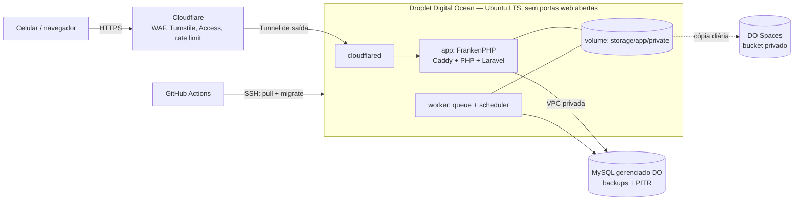

# Deploy e operação

Infraestrutura alvo da v1.0. Decisões: [ADR-0001](../arquitetura/adr/0001-stack.md), [ADR-0012](../arquitetura/adr/0012-mysql-e-sail.md), [ADR-0010](../arquitetura/adr/0010-cloudflare-na-borda.md). Antes de ir para produção, a infraestrutura passa pelo portão de [segurança](../seguranca/README.md).

## Visão geral

| Item | Escolha | Custo aprox. |
|---|---|---|
| Servidor | Droplet básico 1 vCPU / 1 GB | US$ 6/mês |
| Banco | MySQL 8 gerenciado da DO, só na VPC | US$ 15/mês |
| Backup de arquivos | DO Spaces (bucket privado) | US$ 5/mês |
| Borda, HTTPS, WAF | Cloudflare (plano gratuito; avaliar Pro na v0.9 para o OWASP Core Ruleset) | US$ 0–25/mês |
| Acesso ao servidor | Cloudflare Tunnel; SSH só de IPs autorizados | — |
| Domínio | Subdomínio (ex.: `horas.placedev.com.br`) | — |

## Containers (Docker Compose)

| Serviço | Imagem | Função |
|---|---|---|
| `app` | imagem própria baseada em `dunglas/frankenphp` | Servidor web e PHP |
| `worker` | mesma imagem | `php artisan queue:work` e `schedule:work` |
| `cloudflared` | `cloudflare/cloudflared` | Tunnel de saída até a Cloudflare; único caminho de entrada HTTP |

O volume `data` guarda `storage/app/private` (XML/PDF das notas, certificado). O banco fica no MySQL gerenciado.

### Cache dos arquivos estáticos

Os arquivos de `public/build/` têm hash no nome; o Caddy deve servi-los com `Cache-Control: public, max-age=31536000, immutable`, e a Cloudflare os mantém em cache. Assim, a primeira tela baixa CSS e JS uma vez e as navegações seguintes (via `wire:navigate`) buscam só o HTML da página.

## Pipeline

1. Push na `main` → GitHub Actions roda Pint, Larastan e Pest.
2. Build da imagem e push para o GitHub Container Registry.
3. SSH no Droplet: `docker compose pull && docker compose up -d && docker compose exec app php artisan migrate --force && php artisan optimize`.

## Segredos

Ficam no `.env` do servidor, nunca no repositório: `APP_KEY`, credenciais do banco e do Spaces, senha do certificado A1, credenciais de e-mail.

## Backup e restauração

- MySQL gerenciado: backups diários e recuperação em ponto no tempo (retenção do plano).
- Arquivos de `storage/app/private` vão para o Spaces por tarefa agendada diária.
- **Teste de restauração** a cada versão maior: restaurar o backup do MySQL num cluster novo, abrir o sistema e conferir os totais do último período fechado. Registrar data e resultado abaixo.

| Data | Versão | Resultado |
|---|---|---|
| — | — | — |

## Segurança

Controles completos e status em [seguranca/owasp-top-10.md](../seguranca/owasp-top-10.md). Na infraestrutura:

- Firewall da DO: nenhuma porta web aberta; apenas 22 (SSH com chave) de IPs autorizados. Entrada HTTP só pelo Cloudflare Tunnel (SEC-11).
- Cloudflare: TLS Full (strict), HSTS, WAF, rate limit em login e 2FA, Turnstile, Access em `/admin/*` ([ADR-0010](../arquitetura/adr/0010-cloudflare-na-borda.md)).
- Atualizações automáticas de segurança do Ubuntu; usuário de deploy sem senha e sem acesso root direto.
- 2FA obrigatório para administradores; cadastro público desativado ([F-01](../funcionalidades/F-01-acesso-e-seguranca.md)).
- Ambiente de **homologação** separado (subdomínio próprio, dados fictícios, também atrás do Access) para ZAP e testes antes de cada publicação.

## Configuração da Cloudflare (checklist)

Fica fora do repositório; revisar a cada versão e registrar a data abaixo.

- [ ] DNS com proxy ativo; registros do servidor sem IP exposto
- [ ] SSL/TLS: Full (strict), TLS 1.2 mínimo, HSTS com `includeSubDomains`
- [ ] Tunnel ativo e Droplet sem portas 80/443 abertas
- [ ] WAF: regras gerenciadas ativas (OWASP Core Ruleset, se o plano permitir)
- [ ] Rate limiting: `/login`, `/two-factor-challenge`, `/forgot-password`, exportações
- [ ] Turnstile configurado (chaves no `.env`)
- [ ] Access em `/admin/*` com lista de e-mails autorizados
- [ ] Bot Fight Mode ativo
- [ ] Alertas de segurança da Cloudflare por e-mail

| Data | Revisado por | Observações |
|---|---|---|
| — | — | — |
