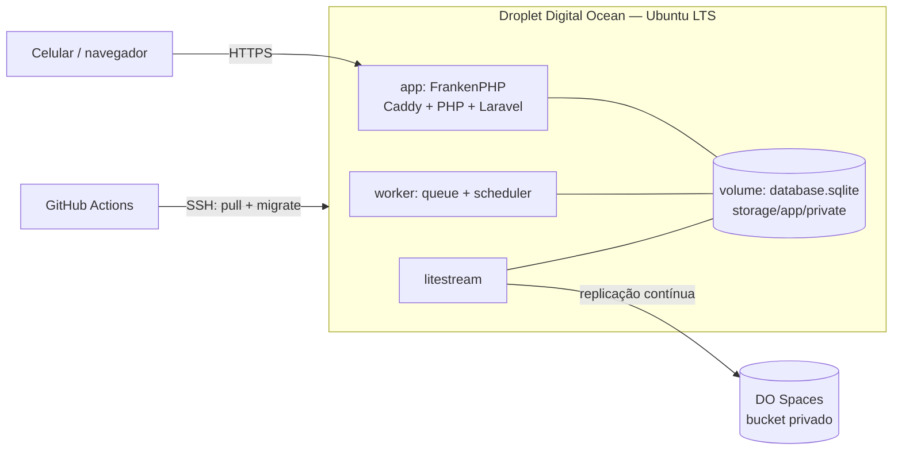

# Deploy e operação

Infraestrutura alvo da v1.0. Decisões: [ADR-0001](../arquitetura/adr/0001-stack.md), [ADR-0003](../arquitetura/adr/0003-sqlite-com-litestream.md).

## Visão geral

| Item | Escolha | Custo aprox. |
|---|---|---|
| Servidor | Droplet básico 1 vCPU / 1 GB | US$ 6/mês |
| Backup do banco | DO Spaces (bucket privado) | US$ 5/mês |
| HTTPS | Caddy (embutido no FrankenPHP) com Let's Encrypt | — |
| Domínio | Subdomínio (ex.: `horas.placedev.com.br`) | — |

## Containers (Docker Compose)

| Serviço | Imagem | Função |
|---|---|---|
| `app` | imagem própria baseada em `dunglas/frankenphp` | Servidor web e PHP |
| `worker` | mesma imagem | `php artisan queue:work` e `schedule:work` |
| `litestream` | `litestream/litestream` | Replica `database.sqlite` para o Spaces |

O volume `data` guarda `database/database.sqlite` e `storage/app/private` (XML/PDF das notas, certificado).

## Pipeline

1. Push na `main` → GitHub Actions roda Pint, Larastan e Pest.
2. Build da imagem e push para o GitHub Container Registry.
3. SSH no Droplet: `docker compose pull && docker compose up -d && docker compose exec app php artisan migrate --force && php artisan optimize`.

## Segredos

Ficam no `.env` do servidor, nunca no repositório: `APP_KEY`, credenciais do Spaces, senha do certificado A1, credenciais de e-mail.

## Backup e restauração

- Litestream replica continuamente, retenção de 30 dias.
- Arquivos de `storage/app/private` vão para o Spaces por tarefa agendada diária.
- **Teste de restauração** a cada versão maior: subir um ambiente limpo, `litestream restore`, abrir o sistema e conferir os totais do último período fechado. Registrar data e resultado abaixo.

| Data | Versão | Resultado |
|---|---|---|
| — | — | — |

## Segurança

- Firewall da DO: apenas 22 (SSH com chave), 80 e 443.
- Atualizações automáticas de segurança do Ubuntu.
- 2FA obrigatório no login; rate limit no Fortify.
- Cadastro público desativado ([F-01](../funcionalidades/F-01-acesso-e-seguranca.md)).
