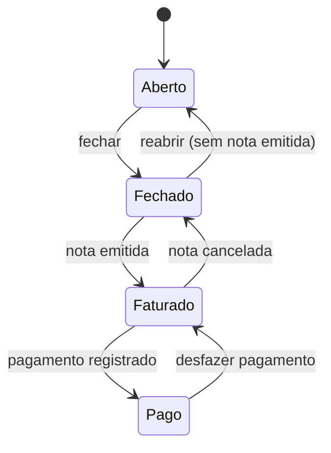

# Regras de negócio

Regras numeradas e estáveis. Cada regra deve ter pelo menos um teste que cite o seu ID. Regras não são apagadas: quando mudarem, marque a antiga como **Revogada** e indique a substituta.

## Tempo e cobrança

### RN-01 — Ponto

1 ponto = 15 minutos. Pontos cobrados são sempre números inteiros.

### RN-02 — Duração

- Todo lançamento tem início e fim com **data e hora** (não só hora).
- Duração = fim − início, guardada em **minutos inteiros**. Segundos são descartados no início e no fim antes do cálculo.
- O fim deve ser maior que o início. Um lançamento pode atravessar a meia-noite (ex.: 23:00 → 01:00 = 120 min) e pertence ao dia/mês do **início**.
- Duração acima de 12 h é recusada; acima de 4 h pede confirmação.

### RN-03 — Sobreposição

Dois lançamentos **do mesmo usuário** não podem se sobrepor no tempo, mesmo em clientes diferentes. Encostar é permitido (um termina 10:00, outro começa 10:00). Lançamentos de usuários diferentes podem coincidir.

### RN-04 — Taxa horária

- Cada cliente tem um histórico de taxas, cada uma com data de início de vigência.
- O lançamento usa a taxa vigente na data do seu início.
- Cliente sem taxa própria usa a taxa padrão das configurações do prestador ([F-02](../funcionalidades/F-02-configuracoes-do-prestador.md)).
- Alterar a taxa nunca muda lançamentos de períodos já fechados ([RN-11](#rn-11--snapshot-do-fechamento)).

### RN-05 — Valor do ponto

Valor do ponto = taxa horária ÷ 4. Com R$ 60/h, o ponto vale R$ 15,00.

### RN-06 — Arredondamento

Cada cliente tem uma política de arredondamento. Só lançamentos de categorias **faturáveis** ([RN-12](#rn-12--categoria-não-faturável)) entram na conta.

| Política | Regra | Uso |
|---|---|---|
| **Período** (padrão) | Soma os minutos do período e arredonda para cima até o próximo ponto inteiro | Recomendada: arredonda uma vez só |
| **Lançamento** | Arredonda cada lançamento para cima até o ponto inteiro e depois soma | Contratos que exigem mínimo de 15 min por atividade |
| **Exato** | Cobra os minutos exatos, sem arredondar | Clientes que pedem cobrança exata |

**Valor do período** = Σ (minutos de cada lançamento × taxa do lançamento ÷ 60) + minutos de arredondamento × taxa vigente no último dia do período ÷ 60. Com uma só taxa no período, isso equivale a pontos × valor do ponto.

**Exemplos com os dados da planilha (R$ 60/h, política Período):**

| Mês | Minutos | Pontos (exatos) | Pontos cobrados | Valor |
|---|---|---|---|---|
| Agosto 2026 | 652 | 43,47 | 44 | R$ 660,00 |
| Setembro 2026 | 1.564 | 104,27 | 105 | R$ 1.575,00 |
| Outubro 2026 (até 26/10) | 1.324 | 88,27 | 89 | R$ 1.335,00 |

### RN-07 — Representação de valores

- Dinheiro é guardado e calculado em **centavos (inteiro)**. Nunca em `float`.
- Tempo é guardado e calculado em **minutos (inteiro)**.
- Divisões monetárias arredondam para o centavo mais próximo (meio para cima) **uma vez**, no total do período.

## Períodos

### RN-08 — Período

- Um período agrupa os lançamentos de **um cliente** em **um mês civil** (pela data de início).
- O período é criado automaticamente no primeiro lançamento do mês para aquele cliente. Não existe "criar mês".

### RN-09 — Estados do período

- **Aberto:** aceita lançamentos; os totais são calculados ao vivo.
- **Fechado:** totais congelados; pronto para a nota.
- **Faturado:** tem nota vinculada (número, data de emissão, XML/PDF).
- **Pago:** tem data e valor recebido.

### RN-10 — Imutabilidade

Lançamentos de um período que não está **Aberto** não podem ser criados, editados nem excluídos. Para corrigir, reabra o período (só possível sem nota emitida).

### RN-11 — Snapshot do fechamento

Ao fechar, o período grava: minutos faturáveis, pontos, taxa(s) usada(s), política de arredondamento, valor em centavos e data do fechamento. Relatório, exportação e nota fiscal leem **sempre** esses números, nunca recalculam.

## Cadastros

### RN-12 — Categoria não faturável

Categorias podem ser marcadas como não faturáveis. Seus lançamentos aparecem no relatório (com valor zero) e não entram no total.

### RN-13 — Cliente inativo

Cliente inativo não aparece na escolha de cliente de novos lançamentos nem do cronômetro, mas seus períodos continuam acessíveis. Cliente com lançamentos não pode ser excluído, só inativado. A mesma regra vale para categorias.

### RN-14 — Cronômetro único

Cada usuário pode ter só um cronômetro rodando por vez. Iniciar outro pede para parar o atual. Ao parar, o cronômetro vira um lançamento comum e passa pelas regras RN-02 e RN-03.

## Acesso

Detalhes em [F-17](../funcionalidades/F-17-usuarios-e-permissoes.md) e [ADR-0007](../arquitetura/adr/0007-permissoes-granulares.md).

### RN-15 — Negado por padrão

Usuário sem perfil e sem exceções não acessa nada além do próprio perfil (nome, senha, 2FA). Toda permissão nova no catálogo nasce desmarcada em todos os perfis.

### RN-16 — Precedência

A permissão efetiva de um usuário comum é calculada nesta ordem:

1. **Negada para o usuário** → negada, sempre.
2. **Permitida para o usuário** → permitida.
3. **Permitida em algum perfil do usuário** → permitida.
4. Caso contrário → negada.

Depois disso, uma permissão só vale se **todas as suas dependências** também valerem (ex.: `billing.period.close` sem `billing.period.view` fica negada).

### RN-17 — Administrador

- Administrador tem todas as permissões e é o único que gerencia usuários, perfis e exceções.
- Sempre existe pelo menos um administrador ativo: o sistema recusa desativar, excluir ou rebaixar o último.
- Um administrador não pode rebaixar a si mesmo.

### RN-18 — Interface e servidor

Elemento escondido por falta de permissão também é bloqueado no servidor: a ação correspondente responde 403 se chamada diretamente. A checagem que vale é a do caso de uso.

### RN-19 — Usuário desativado

Usuário desativado não faz login e tem as sessões encerradas na hora. Seus lançamentos e registros continuam no sistema e no histórico.

### RN-20 — Auditoria

Toda mudança em usuários, perfis, exceções e status de período registra quem fez, quando, e o valor antes e depois. O registro não pode ser editado nem excluído pela interface.
