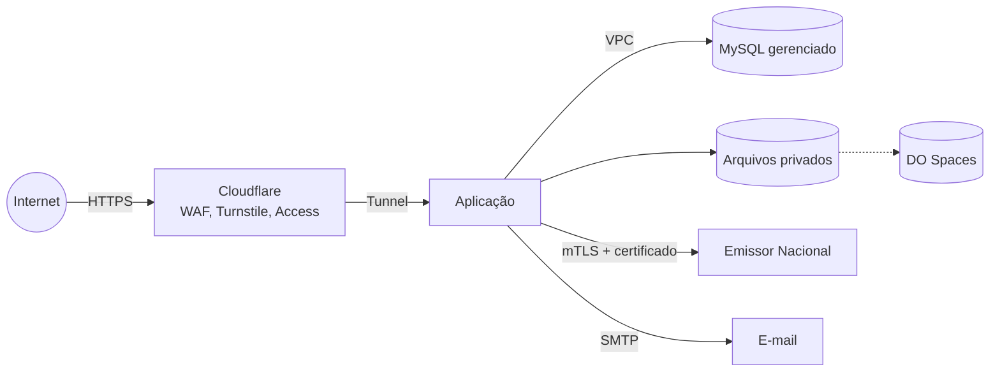

# Modelo de ameaças

Atualizar a cada versão. Método: STRIDE simplificado por funcionalidade.

## O que proteger

| Ativo | Por quê | Onde fica |
|---|---|---|
| Certificado A1 e senha | Permite emitir notas em nome da empresa | Disco privado criptografado + variável de ambiente |
| Dados fiscais e de clientes (CNPJ, endereços, valores) | Dados de terceiros, sigilo comercial, LGPD | MySQL |
| Permissões e contas de administrador | Quem é administrador controla tudo | MySQL |
| Notas emitidas (XML/PDF) | Documento fiscal; adulteração ou perda tem efeito legal | Disco privado + backup |
| Segredos (`APP_KEY`, chaves do Spaces, SMTP) | Comprometem todo o resto | `.env` do servidor |
| Disponibilidade | Lançamento de horas e emissão no prazo | Droplet + Cloudflare |

## Quem pode atacar

| Agente | Motivação | Acesso |
|---|---|---|
| Atacante externo automatizado | Credenciais, servidor para abuso | Internet |
| Atacante direcionado | Dados fiscais, emitir nota falsa | Internet, phishing |
| Usuário convidado mal-intencionado ou com conta roubada | Ver valores, escalar permissão, alterar horas | Conta válida com perfil limitado |
| Cliente com link público | Acessar outros relatórios | Link assinado |
| Dependência comprometida | Execução de código | Cadeia de suprimentos |

## Fronteiras de confiança

Toda entrada que cruza uma seta vinda de fora é validada; toda saída para fora é registrada.

## Ameaças por funcionalidade

| Funcionalidade | Ameaça (STRIDE) | Controles |
|---|---|---|
| F-01 Acesso | Força bruta, enumeração de e-mails, sequestro de sessão, convite reutilizado (S) | SEC-07, SEC-31, SEC-32, SEC-33, SEC-35, SEC-36 |
| F-17 Permissões | Escalada de privilégio via requisição direta ao Livewire, alteração de propriedade pública, perfil se auto-promover (E) | SEC-01, SEC-02, SEC-04, SEC-29, SEC-34, SEC-41, SEC-46 |
| F-03 Clientes | Usuário lê dados fiscais de cliente sem permissão (I) | SEC-01, SEC-03, campos `field` do catálogo |
| F-05/F-06 Lançamentos | Alterar horas de outro usuário (IDOR), lançar em período fechado (T) | SEC-03, SEC-29, RN-10 |
| F-07 Importação | Zip bomb, XXE dentro do `.xlsx`, arquivo enorme (D, E) | SEC-27, SEC-30 |
| F-08 Períodos | Reabrir período já faturado, mudar valor após fechar (T) | SEC-29, RN-09, RN-11, SEC-41 |
| F-09 Relatório | CSV com fórmula maliciosa aberta pelo cliente no Excel (T) | SEC-26 |
| F-12 NFS-e | Roubo do certificado, XXE no XML anexado, emissão duplicada, nota com valor adulterado (S, T, I) | SEC-06, SEC-18, SEC-25, SEC-34, SEC-40, SEC-48 |
| F-13 Link público | Adivinhar ou reutilizar link de outro cliente (I) | SEC-07, rate limit |
| F-14 Fator R | Exposição de pró-labore e faturamento (I) | Permissões `content` |
| Infraestrutura | DDoS, varredura de portas, servidor exposto, backup público (D, I) | SEC-11, SEC-12, SEC-20, ADR-0010 |
