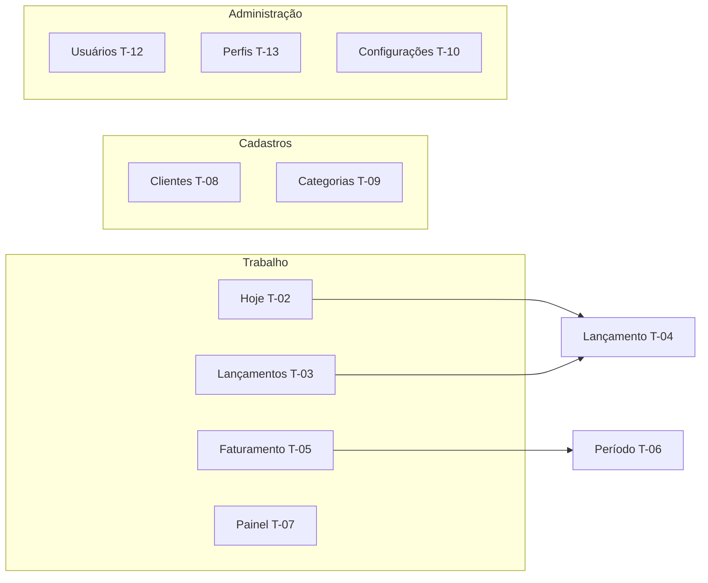

# Telas

Uma página por tela, criada a partir de [_templates/tela.md](../_templates/tela.md). A linguagem visual (estrutura de console, tokens, o que é proibido) está em [design/linguagem-visual.md](../design/linguagem-visual.md).

As telas T-01 a T-11 trazem o wireframe da versão de celular (390 px), onde o uso diário acontece; a versão desktop segue o modelo de console descrito abaixo. As telas de administração (T-12, T-13) trazem o wireframe desktop.

| ID | Tela | Rota | Funcionalidades | Status |
|---|---|---|---|---|
| [T-01](T-01-login.md) | Login | `/login` | F-01 | 📋 Planejado |
| [T-02](T-02-hoje.md) | Hoje | `/` | F-05, F-06 | 📋 Planejado |
| [T-03](T-03-lancamentos.md) | Lançamentos | `/time-entries` | F-05 | 📋 Planejado |
| [T-04](T-04-lancamento.md) | Lançamento (criar/editar) | `/time-entries/create`, `/time-entries/{id}` | F-05, F-16 | 📋 Planejado |
| [T-05](T-05-faturamento.md) | Faturamento | `/billing` | F-08 | 📋 Planejado |
| [T-06](T-06-periodo.md) | Período | `/billing/{id}` | F-08, F-09, F-12 | 📋 Planejado |
| [T-07](T-07-painel.md) | Painel | `/dashboard` | F-10, F-14 | 📋 Planejado |
| [T-08](T-08-clientes.md) | Clientes | `/clients` | F-03 | ✅ Implementada (v0.3) |
| [T-09](T-09-categorias.md) | Categorias | `/categories` | F-04 | ✅ Implementada (v0.3) |
| [T-10](T-10-configuracoes.md) | Configurações | `/settings` | F-01, F-02, F-07, F-12, F-14 | 🚧 Em andamento |
| [T-11](T-11-relatorio-publico.md) | Relatório público | `/r/{token}` | F-13 | 💡 Ideia |
| [T-12](T-12-usuarios.md) | Usuários | `/admin/users` | F-01, F-17 | ✅ Implementada (v0.2) |
| [T-13](T-13-perfis-de-acesso.md) | Perfis de acesso | `/admin/roles` | F-17 | ✅ Implementada (v0.2) |

## Navegação

- **Desktop:** barra superior (contexto de cliente, busca `/`, cronômetro, usuário) + navegação lateral agrupada em **Trabalho**, **Cadastros** e **Administração**. Criar e editar abrem o painel lateral à direita.
- **Celular:** os quatro itens de **Trabalho** ficam numa barra inferior; o restante fica na gaveta do menu. Formulários abrem como folha inferior.
- **Cronômetro:** visível na barra superior (desktop) ou numa faixa acima da barra inferior (celular) enquanto estiver rodando ([F-06](../funcionalidades/F-06-cronometro.md)).
- **Permissões:** itens de menu, botões, campos e textos só aparecem com a permissão correspondente ([F-17](../funcionalidades/F-17-usuarios-e-permissoes.md)). Cada tela lista suas permissões no catálogo do módulo.

## Checklist de entrega de uma tela

- [ ] Segue o modelo lista → detalhe → painel lateral, quando aplicável.
- [ ] Usa apenas tokens e componentes `ui.*`.
- [ ] Permissões da tela declaradas no catálogo e aplicadas em menu, página, ações, campos e conteúdo.
- [ ] Estados vazio, carregando, erro e sem permissão desenhados.
- [ ] Funciona em 390 px e em 1440 px; teclado e leitor de tela.
- [ ] Nenhum dado sensível em URL; saída escapada; ações destrutivas com confirmação e, se sensíveis, reautenticação (SEC-34).
- [ ] Revisada contra a lista "Contra a cara de IA" da linguagem visual.
